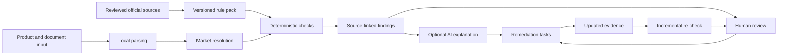

# Architecture and trust boundaries

SilkGuard is designed as a review workflow, not an autonomous legal decision-maker.

## Authority model

- Official sources establish what a maintained rule pack is based on.
- Deterministic controls decide whether submitted evidence matches a configured condition.
- An LLM may explain findings or draft remediation language, but cannot add requirements or approve a case.
- A human reviewer decides whether evidence is adequate for the organization's internal workflow.
- External counsel, laboratories, certification bodies, marketplaces, and authorities remain authoritative for their respective decisions.

## Evidence tiers

`official_deterministic` means a maintainer-reviewed, source-linked rule pack exists in this prototype. It does not mean an authority has endorsed SilkGuard or certified a product.

`advisory_only` means the market entry is navigation metadata. The application must fail closed: it may preserve case information and identify missing coverage, but it cannot run another jurisdiction's rules or issue a compliance decision.

## Data storage

SQLite runtime data and uploaded files are stored below `var/` by default. Both are excluded from Git. Deployments should use an encrypted storage layer, access controls, retention limits, audit logging, and a documented deletion process appropriate to the data handled.

## Updating a rule pack

1. Retrieve an authoritative source.
2. Record jurisdiction, version/effective date, URL, and retrieval metadata.
3. Draft the rule change without replacing the released rule pack.
4. Require human review.
5. Add regression tests.
6. Publish a versioned release and re-check affected cases.
